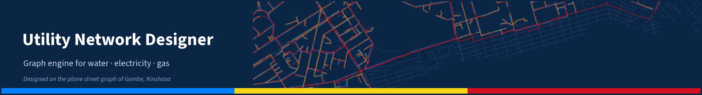

# Utility Network Designer (graph engine)

A QGIS plugin that designs the water, electricity and gas distribution networks of a district on its plane
street graph, checks every design rule, analyses reliability and draws the engineering drawings.

## Algorithms (Processing toolbox, group *Utility networks*)

| Algorithm | What it does |
|---|---|
| **Design utility networks** | From streets, buildings and the district boundary: water mains, LV cables, transformers and 20 kV rings, gas pipes and regulators, services, and the side of every main; validation table, customer register; layers loaded into the project. |
| **Analyse reliability and crossings** | Valve segments, N-1, metered districts and fire flow (water); LV ties, open rings, trench cuts and load growth (electricity); depths at crossings and street cuts (corridor). |
| **Engineering drawings** | Longitudinal profile, cross-section, junction plan, MV single-line diagram (PDF and PNG). |

## Data

Required, in one projected CRS in metres: street centrelines (noded or not; `road_class` or OSM `highway`
optional), building footprints, the district boundary. Optional: water bodies, railways, points of interest,
land use, an elevation raster, the locations of the MV infeed and of the gas gate, a population.

## Requirements

QGIS 3.28 or later with numpy, scipy, pandas, shapely, geopandas, networkx and matplotlib (shipped with the
QGIS 3.44 installation for Windows on which the plugin was tested).

## Background

The engine and its propositions are described in the paper series by C. B. Mwimangire on utility networks
for Gombe (Kinshasa) and in the book *Designing Utility Networks with Graph Theory*. The colours are those of
the flag of the Democratic Republic of the Congo, which are also the colours of the uniform code for water
(sky blue), gas (yellow) and electricity (red).

Licence: MIT.
